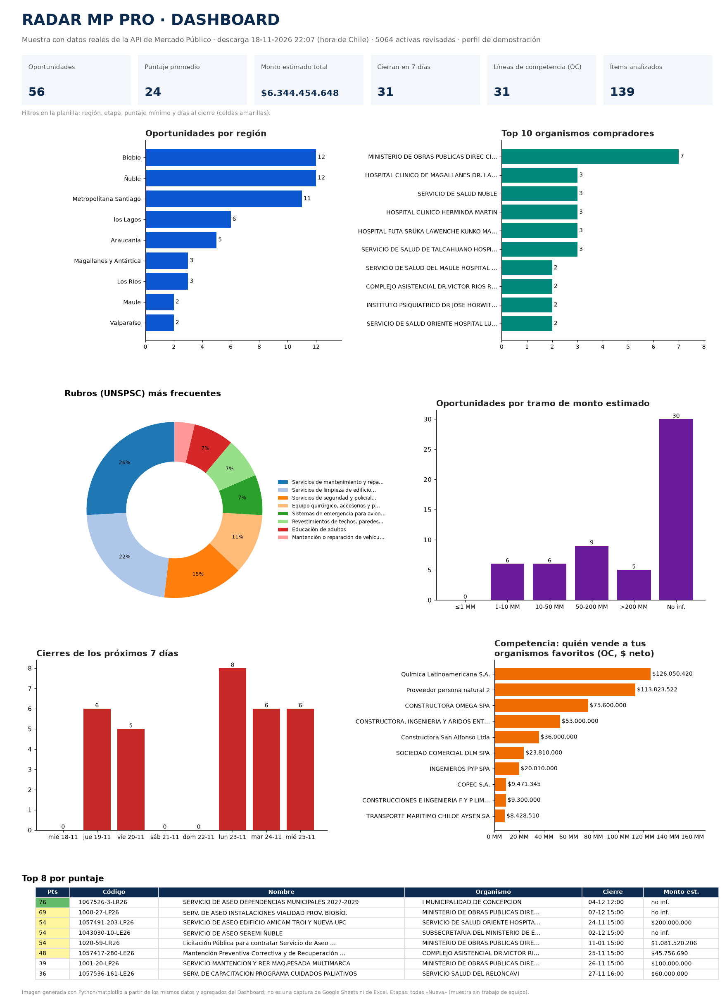

# Radar MP: tu radar de oportunidades en Mercado Público (Google Sheets + Apps Script + Power BI)

Radar abierto para proveedores del Estado de Chile. Consulta cada día la [API pública de Mercado Público](https://www.chilecompra.cl/api/), encuentra las licitaciones que calzan con tu negocio, les asigna un puntaje, organiza el trabajo de tu equipo y te muestra quién le vende a quién y a qué precio.

Es el material del capítulo 6 del Volumen 7 de **«Véndele al Estado y No Mueras en el Intento»** (Enrique Varas · [FirmaVB](https://www.firmavb.cl)). Trae dos versiones:

| Versión | Carpeta | Para quién |
|---|---|---|
| **Básica** | `basico/` | Tu primer radar. Usa 3 hojas, busca palabras clave en el nombre de la licitación, lee la ficha y te manda un correo diario. Se instala en 15 minutos. |
| **Pro** | `pro/` | Agrega puntaje de 0 a 100 con sus motivos, ficha completa, pipeline del equipo, historial, inteligencia de competencia (órdenes de compra y adjudicaciones), dashboard con gráficos y filtros, y hojas para Power BI. |
| **Microsoft** | `powerquery/`, `POWER_BI.md` | Consultas Power Query (M) para Excel y Power BI, más una guía de modelo, medidas DAX y visuales. |

No necesitas saber programar: si sabes copiar y pegar, puedes instalarlo. Y si quieres modificarlo con IA, `PROMPT_CONSTRUCCION.md` te guía para construirlo desde cero con Claude o ChatGPT.


*Dashboard de muestra con datos reales de la API (18-11-2026). Los proveedores que son personas naturales están anonimizados. La imagen se generó con Python a partir de los mismos datos; no es una captura de Google Sheets.*

---

## 1. Qué hace la versión Pro, en simple

| Qué | Para qué te sirve |
|---|---|
| **Revisa todas las licitaciones publicadas** cada mañana (unas 5.000) | No dependes de acordarte de buscar |
| **Lee la ficha completa** de las que calzan: organismo, unidad, región, comuna, tipo, monto estimado, fechas de publicación, cierre, preguntas y adjudicación, rubro y productos | Decides sin abrir 30 pestañas |
| **Les pone un puntaje de 0 a 100** y te explica por qué («aseo en nombre +36; región de interés +10») | Atiendes primero lo que más te conviene |
| **Pipeline** con etapas: Nueva → Revisar → Postular → Postulada → Ganada / Perdida / Descartada | Todo el equipo sabe en qué está cada oportunidad |
| **Historial** de cada cambio (nueva fecha de cierre, licitación que se cae, cambio de etapa) | Nada cambia sin que te enteres |
| **Competencia**: órdenes de compra de tus organismos favoritos y adjudicaciones de tu rubro | Sabes quién vende, qué vende y a qué precio |
| **Dashboard** con indicadores, 6 gráficos y filtros | Ves el panorama en 10 segundos |
| **Correo diario** con las mejores oportunidades y los cierres de la semana | Te llega a la bandeja, no tienes que abrir la planilla |
| **Hojas para Power BI y Excel** | Si tu empresa usa Microsoft, también te sirve |

Lo que **no** hace: no postula por ti, no lee las bases (los PDF) y no reemplaza tu criterio. Siempre revisa la ficha y las bases en mercadopublico.cl antes de decidir.

---

## 2. Qué necesitas

1. **Una cuenta de Google** (Gmail o Google Workspace).
2. **Tu ticket de la API de Mercado Público.** Es gratis y se pide en https://www.chilecompra.cl/api/ con tu Clave Única. Te llega por correo. **Trátalo como una contraseña**: no lo subas a GitHub, no lo pegues en chats ni en la planilla. En este repositorio solo aparece el marcador `TU_TICKET_AQUI`.
3. Si solo quieres probar antes de pedir el tuyo, ChileCompra publica un ticket de ejemplo en esa misma página. Es compartido, así que verás errores de «peticiones simultáneas» con frecuencia.

---

## 3. Instalación paso a paso

### 3.1 Versión básica (`basico/`)

1. Crea una planilla nueva en Google Sheets. Si quieres partir con las hojas listas, importa `basico/Plantilla_Radar_MP.xlsx` (**Archivo › Importar**) o los CSV de `basico/csv/`.
2. Ve a **Extensiones › Apps Script**.
3. Borra el contenido de `Código.gs` y pega todo `basico/Code.gs`.
4. En **Configuración del proyecto** (el engranaje), activa «Mostrar el archivo de manifiesto appsscript.json». Luego reemplaza el contenido de `appsscript.json` por el de `basico/appsscript.json`.
5. Guarda y recarga la planilla (F5). Aparece el menú **Radar MP**.
6. Usa el menú para guardar tu ticket, probar la conexión, ejecutar y activar la ejecución diaria. La primera vez Google pide autorización y muestra el aviso de «app no verificada»: es normal, porque el script es tuyo. Entra a «Configuración avanzada» y acepta.

### 3.2 Versión Pro (`pro/`)

1. Crea una planilla nueva en Google Sheets (por ejemplo, «Radar MP Pro»).
2. Ve a **Extensiones › Apps Script**, borra el contenido de `Código.gs` y pega todo `pro/apps_script/Code.gs`.
3. En **Configuración del proyecto**, activa el manifiesto y reemplaza `appsscript.json` por `pro/apps_script/appsscript.json`. Así queda la zona horaria de Chile y se piden solo los permisos necesarios.
4. Guarda y recarga la planilla. Aparece el menú **Radar MP Pro**.
5. **Radar MP Pro › ★ Instalar o reparar (un clic)**. Crea las hojas, el formato, los desplegables, el dashboard con sus gráficos y la ejecución diaria. Puedes repetirlo cuando quieras: no borra tus datos.
   - Permisos que pide: editar **esta** planilla, conectarse a servicios externos (la API), enviarte correo, ejecutarse cuando no estás (el activador diario) y mostrar menús.
6. **Radar MP Pro › Guardar mi ticket**. Queda en las propiedades del script, **no en la planilla**.
7. **Radar MP Pro › Probar conexión**. Debe informar unas 5.000 licitaciones activas.
8. Completa la hoja **Configuración** (sección 4) y usa **Ejecutar ahora**.

---

## 4. Configura tu radar (hoja «Configuración»)

**Celdas amarillas (columna B):**

| Parámetro | Recomendación |
|---|---|
| Correo para alertas | El tuyo o el del equipo comercial |
| Hora de ejecución diaria | 6 (las 06:00). ChileCompra recomienda descargas masivas entre 22:00 y 07:00 |
| Puntaje mínimo para alertar | 35 para partir. Si te llegan demasiadas, súbelo |
| Fichas por lote | 40 |
| Máximo de fichas por día | 800 |
| Búsqueda amplia | **NO** al principio. Con **SI** lee la ficha de todas las licitaciones nuevas (encuentra las que no dicen tu palabra en el título, pero es más lento) |
| Monto mínimo y máximo | Opcional. Lo que esté fuera del rango baja 15 puntos |
| Días mínimos al cierre | 3. Si cierra antes, baja 30 puntos (no alcanzas a preparar la oferta) |
| Días hacia atrás para competencia | 3 |
| Seguir adjudicación de mis postulaciones | SI |
| RUT de mi empresa | Para que marque «GANADA por tu empresa» cuando salga la adjudicación |
| Adjudicaciones de mi rubro | SI |

**Listas (a la derecha):**

- **Palabra clave + Peso (1 a 5):** escribe las palabras como las escribe el comprador, no como tú vendes. Usa `*` al final para aceptar variantes: `mantencion*` encuentra mantención, mantenciones, mantencion. Las tildes y mayúsculas no importan.
- **Excluir si contiene:** palabras que descartan una licitación (por ejemplo, `vehiculo*` si haces aseo pero no lavado de autos).
- **Regiones de interés:** si escribes alguna, las demás regiones bajan 20 puntos.
- **Cód. organismo favorito:** el código numérico del organismo (lo ves en la columna «Cód. organismo» de la hoja Licitaciones). Suma 15 puntos y activa la inteligencia de competencia para ese organismo.
- **Rubro UNSPSC (prefijo) + Peso:** opcional, para quienes conocen su código de rubro (ejemplo: `7611` = servicios de limpieza).

### Cómo se calcula el puntaje

| Señal | Puntos |
|---|---|
| Palabra clave en el **nombre** | peso × 12 |
| Palabra clave en la **descripción** | peso × 8 |
| Palabra clave solo en los **ítems** | peso × 6 |
| Rubro UNSPSC configurado | peso × 6 |
| Región de interés / fuera de tus regiones | +10 / −20 |
| Organismo favorito | +15 |
| Monto dentro / fuera de tu rango | +5 / −15 |
| Cierra antes de tus días mínimos | −30 |

El máximo es 100. La columna **Motivos** muestra el detalle de cada caso.

---

## 5. Uso diario

1. **Menú › Ejecutar ahora** la primera vez. Si hay muchas fichas que leer, el radar trabaja en **lotes de unos 5 minutos** y sigue solo cada minuto hasta terminar (Google corta cada ejecución a los 6 minutos). Puedes ver en qué va con **Menú › Ver estado del ciclo**.
2. Después corre solo cada mañana y te manda el correo.
3. En **Licitaciones** trabaja las columnas moradas: **Etapa** (desplegable), **Responsable**, **Próxima acción**, **Fecha próxima acción** y **Notas**. El radar **nunca** las sobrescribe.
4. En **Dashboard** usa las celdas amarillas para filtrar por región, etapa, puntaje mínimo y días al cierre. En **Licitaciones** también tienes segmentadores (filtros con botones) de Región y Etapa.
5. Revisa **Registro** una vez por semana. Si dice ERROR, el radar no funcionó ese día: **«sin novedades» no es lo mismo que «falló»**, y si falla recibes un correo aparte.

### Las hojas

| Hoja | Qué tiene |
|---|---|
| Inicio | Instrucciones cortas |
| Dashboard | Indicadores, top 15 y gráficos |
| Configuración | Tus parámetros |
| Licitaciones | Una fila por oportunidad, con su ficha completa y tu pipeline |
| Ítems | El detalle de productos o servicios de cada licitación |
| Competencia | Quién vende y a qué precio (órdenes de compra y adjudicaciones) |
| Historial | Cada cambio, con fecha |
| Registro | Cada ejecución: qué hizo, cuántas consultas usó y si falló |
| PBI_Licitaciones, PBI_Items, PBI_Competencia | Copias planas para Power BI o Excel |
| _dash, _cola, _vistas, _hechos | Hojas técnicas ocultas. No las edites |

---

## 6. Inteligencia de competencia

- **Órdenes de compra de tus organismos favoritos.** Para cada organismo y cada día de la ventana, el radar trae las órdenes de compra y lee cada una: **proveedor, RUT, producto, cantidad y precio neto unitario**. Si configuraste rubros UNSPSC, guarda solo las líneas de tus rubros.
- **Adjudicaciones de tu rubro.** Lee las licitaciones adjudicadas de los últimos días que calzan con tus palabras clave: **quién ganó, cuántas unidades, a qué monto unitario y cuántos oferentes hubo**.
- **Seguimiento de tus postulaciones.** Cuando una licitación en Postular o Postulada cierra, el radar relee su ficha y anota el resultado. Con tu RUT configurado, marca «GANADA por tu empresa».

Comprobado contra la API real el 18-11-2026: `ordenesdecompra.json` entrega proveedor, producto y precio neto por línea. Ojo: en algunas órdenes el campo «Total» de la línea viene en 0; por eso el radar calcula cantidad × precio neto. Las adjudicaciones traen RUT y nombre del adjudicado, cantidad, monto unitario y número de oferentes.

---

## 7. Power BI y Excel (Microsoft)

Tienes dos caminos. Los detalles están en `POWER_BI.md`.

**Camino A, el más simple: Google hace las consultas y Microsoft solo lee.**
Menú › Preparar hojas para Power BI. Luego, en Google Sheets, **Archivo › Compartir › Publicar en la Web**, elige la hoja `PBI_Licitaciones` y el formato **CSV**. Copia el enlace y úsalo en Power BI o Excel con la consulta `powerquery/06_Desde_CSV_Publicado.pq`. Repite con `PBI_Items` y `PBI_Competencia`.
> Ojo: lo publicado queda visible para cualquiera que tenga el enlace. Las hojas PBI no incluyen Responsable, Próxima acción ni Notas.

**Camino B: Excel o Power BI consultan la API directo.**
- `powerquery/Radar_MP_PowerQuery.xlsx`: libro de Excel con la consulta ya incrustada. Ábrelo en Excel para Windows o Mac (Microsoft 365), escribe tu ticket en la hoja **Parámetros** (celda B3), ajusta palabras clave y usa **Datos › Actualizar todo**. Viene precargado con datos reales de muestra.
- Si Excel pregunta por «niveles de privacidad», elige **Organizacional** para el libro y para api.mercadopublico.cl.
- En Power BI Desktop: copia las consultas de `powerquery/` (01 a 05) y sigue `POWER_BI.md`.

---

## 8. Límites que debes conocer

| Límite | Valor | Qué hace el radar |
|---|---|---|
| Consultas a la API por ticket | 10.000 al día | Se detiene en 9.000 (tope propio) y sigue al día siguiente |
| Peticiones simultáneas | Prohibidas (error 429, código 10500) | Una consulta a la vez, pausa de 1,5 s, reintenta a los 10, 30 y 60 s |
| Duración de cada ejecución de Apps Script | 6 minutos | Trabaja en lotes de 4,5 minutos y continúa solo |
| Tiempo total de activadores (cuenta gmail.com) | 90 minutos al día (Workspace: 6 horas) | Máximo 18 lotes por día |
| Correos (cuenta gmail.com) | 100 destinatarios al día | 1 correo diario + avisos de falla |
| Consultas externas de Apps Script (gmail.com) | 20.000 al día | Muy por encima de lo que usa el radar |

Valores verificados el 18-11-2026 en https://www.chilecompra.cl/api/ y en la página de cuotas de Google Apps Script. Pueden cambiar.

---

## 9. Problemas frecuentes

| Ves esto | Qué significa | Qué hacer |
|---|---|---|
| «revisa tu ticket» (código 203) | El ticket no es válido | Vuelve a copiarlo desde chilecompra.cl y usa Guardar mi ticket |
| «peticiones simultáneas» (429 / 10500) | Hubo otra consulta con tu ticket al mismo tiempo (otra planilla, otra persona) | Usa tu ticket en un solo radar. El radar reintenta solo |
| «Lote terminado; continúa en 1 minuto» | Normal: se acabó el tiempo de esa ejecución | Nada. Sigue solo |
| «Máximo de continuaciones alcanzado» | Ese día hubo demasiadas fichas | Baja el «Máximo de fichas por día» o desactiva la búsqueda amplia |
| «HTTP 504» | La API estuvo lenta | El radar reintenta. Si se repite, prueba de noche |
| Monto «no informado» | El organismo ocultó el monto en la ficha | Es un dato real, no un error |
| El dashboard muestra «(sin datos)» | No hay filas con esos filtros | Pon los filtros amarillos en «Todas» / «Todos» y puntaje 0 |

---

## 10. Para quienes programan

```
basico/            Code.gs, appsscript.json, plantilla xlsx/csv y pruebas (simulador de Apps Script en Node)
pro/apps_script/   Code.gs (~1.200 líneas, V8) y appsscript.json
pro/pruebas/       simulador_gas_pro.js, 26 pruebas offline y prueba contra la API real
pro/pruebas/fixtures/  respuestas reales de la API SANEADAS (sin contactos, correos, teléfonos ni personas naturales)
pro/muestra/       planilla y dashboard de muestra (personas naturales anonimizadas) y anonimizar.py
powerquery/        consultas M (00–06) y Radar_MP_PowerQuery.xlsx con la consulta incrustada
herramientas/      validar_m.js (parser oficial de Microsoft) y sanear_fixtures.py
```

Pruebas (Node 18 o superior, sin dependencias):

```bash
node basico/pruebas/prueba_radar.js        # 16 pruebas offline
node pro/pruebas/prueba_radar_pro.js       # 26 pruebas offline con fixtures saneados
MP_TICKET=TU_TICKET_AQUI node pro/pruebas/prueba_real_pro.js   # contra la API real (usa curl)
cd herramientas && npm install && npm run validar-m             # sintaxis de las consultas M
```

**Arquitectura de la versión Pro.**
- Es una máquina de estados guardada en `PropertiesService`: ACTIVAS → FICHAS → SEGUIMIENTO → COMPETENCIA → CIERRE.
- Los lotes terminan a los 4,5 minutos y dejan programado un activador `continuarRadar`, con un máximo de 18 al día.
- Usa `LockService` para que no corran dos ejecuciones a la vez y `CacheService` para no leer dos veces la misma ficha.
- Hace una consulta a la vez, con pausa y reintentos ante 429 y 5xx. El error 203 (ticket inválido) no se reintenta.
- El ticket se enmascara en todo log y correo.
- El script nunca escribe en las columnas del equipo (Etapa, Responsable, Próxima acción, Notas).

**Privacidad (Ley 19.628 y Ley 21.719).**
- Las fichas de la API traen nombres, correos y teléfonos de funcionarios, y algunos proveedores son personas naturales.
- El radar no guarda los campos de contacto. Aun así, antes de compartir una planilla o publicar datos, revisa que no queden datos personales. `pro/muestra/anonimizar.py` y `herramientas/sanear_fixtures.py` muestran cómo hacerlo, con una heurística que conviene revisar a mano.

**Qué está probado y qué no.**
- Probado: las pruebas offline, una corrida real contra la API (18-11-2026) y la sintaxis de las consultas M.
- Sin probar: la ejecución dentro de Google Sheets (gráficos, segmentadores, activadores y correo) y la actualización en Excel o Power BI. No hay archivo .pbix porque se preparó en Linux.

¿Quieres mejorarlo? Abre un *issue* o un *pull request*. Ideas: mapa de calor por comuna, base de datos (Supabase o Postgres) para no saturar Google Sheets con el volumen diario, alertas por WhatsApp o Slack, y match de tu inventario contra los ítems con IA.

---

Licencia MIT · © 2026 Enrique Varas / FirmaVB. Úsalo, cópialo y mejóralo. Siempre revisa la ficha y las bases en mercadopublico.cl antes de postular.

**¿Prefieres que te lo armemos? WhatsApp +56 9 9099 6055 · evaras@firmavb.cl**
